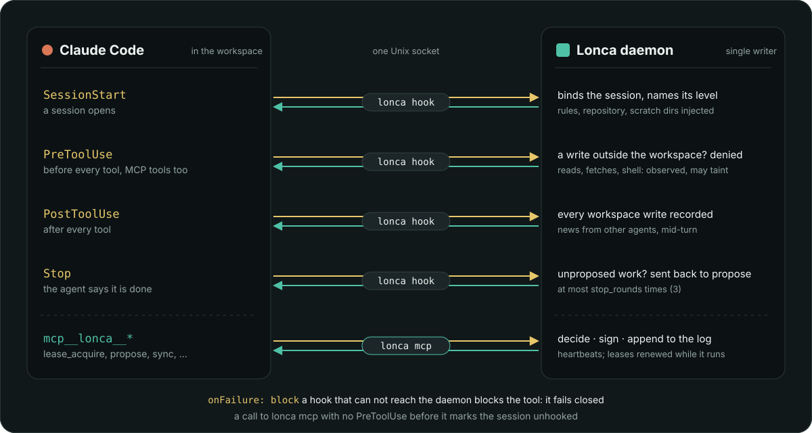
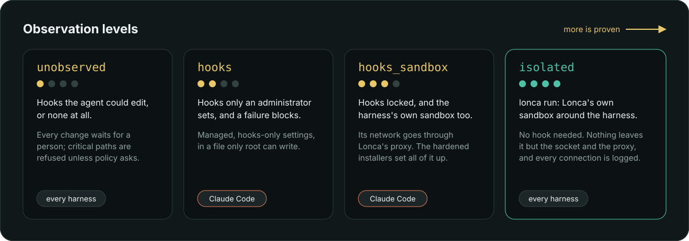

# Lonca with Claude Code

Claude Code is the harness Lonca is built and checked against. Every hook event
it has, its MCP client and its managed settings each have a job in Lonca, and
every release is run live with it before it ships. Everything on this page
works today.



## What you get

| You get | How |
|---|---|
| **The rules, from the first turn** | `SessionStart` binds the session to the daemon and injects the repository, the session, its observation level, its scratch directories and the rules: lease before editing, propose with the symbols changed, sync after integration. |
| **Writes kept in the workspace** | `PreToolUse` denies a write outside the workspace and its scratch roots, also one that a symbolic link inside the workspace leads out of it, a write to `.lonca/`, and a shell command that names Lonca's own files (the socket, keys, settings). |
| **Every write on the record** | `PostToolUse` records each write in the workspace. A proposal that changes a file no observed tool wrote is denied or waits for a person (`unobserved_write:<path>`). |
| **News while it works** | A lease handed over, a change integrated or rejected, a message from another agent: the daemon adds them to the answer of the next tool call, so a busy agent hears them mid-turn. |
| **No "done" with work left behind** | `Stop` sends local changes to the daemon. If no proposal carries them, the agent is told what is unproposed and goes on, up to `[sessions] stop_rounds` times (3). |
| **Fails closed** | Every hook has `onFailure: block`, and `lonca hook` exits 2 when it can not reach the daemon, so a stopped daemon blocks tools instead of letting them through unwatched. |
| **A session's directory is the log's word** | The hook does not take a broken, missing or edited `.lonca/workspace.json` for "not a Lonca session": it asks the daemon which session was started in that directory, or is bound to that Claude Code session, and blocks the tool when that session's metadata does not read. |
| **Proof the hooks ran** | Claude Code fires `PreToolUse` for MCP tools too, so every call to `lonca mcp` must come after its event. One that does not marks the session `unhooked`: something skipped the hooks. |
| **Lonca's own tools** | `lonca mcp`: leases, previews, proposals, sync, negotiation. While it runs it sends heartbeats and renews the session's leases. |
| **A higher level when you lock it** | With managed settings the session is `hooks_sandbox`, the highest level a hook-based harness reaches. Under `lonca run`, `isolated`. |

## Set up in one command

```sh
lonca session start --repo demo --agent claude --paths 'src/**' \
      --task T-142 --ttl 2h --workspace ~/ws/claude-1 --harness claude-code
cd ~/ws/claude-1
claude
```

`--harness claude-code` names the harness in the signed start, so the daemon reads
Claude Code's profile for this session, and writes two files into the workspace:

- `.mcp.json`: the `lonca` MCP server, with the daemon's socket and the workspace.
- `.claude/settings.local.json`: the hooks above, `enabledMcpjsonServers: ["lonca"]`,
  and approval of Lonca's own tools (`mcp__lonca__*`), so the agent is not asked
  about each one.

Neither file is ever a local change: they are in no `diff` and no proposal. For a
runner that keeps the workspace clean, `lonca harness setup claude-code --print`
writes nothing and gives the `--mcp-config` and `--settings` flags to start
`claude` with. The settings in full, and the environment they need, are in
[Running agents](runners.md#claude-code-settings).

On a hardened install neither file is written and there are no flags to pass: the
MCP server, the hooks and the approval of Lonca's tools are in files only root can
change (below), and Claude Code exits when it is started with `--mcp-config` there.

## The tools Claude Code sees

| Tool | What it does |
|---|---|
| `status` | Trunk, the queue, every active lease (who holds what and why), the session and its changes |
| `symbols` | A file's symbols with the ids to lease (`path#Type.method`), and the sections of Markdown, TOML, JSON and YAML files |
| `lease_needed` | The leases the local changes need, and who holds the ones that are not free |
| `lease_acquire`, `lease_renew`, `lease_release` | Lease symbols before editing them: all or nothing, never waiting |
| `lease_interest` | Wait for symbols another session holds, without blocking: they are reserved for you when freed |
| `negotiate` | Settle a lease with the agent that holds it: claim, split, yield |
| `preview` | The facts of the local changes as Lonca computes them, to copy into a proposal |
| `propose` | Submit the changes; the merge queue builds, tests and integrates them |
| `change_status` | Where a change is, with the evidence of its last integration attempt |
| `sync` | Bring trunk into the workspace, keeping local edits |
| `events` | What happened that the agent should know of |

Two Claude Code sessions can edit one file at the same time as long as they
lease different symbols, and both changes integrate.

## How much is proven



The level decides how much a session's changes are trusted, and a policy can ask for
one by path (`context.observation` in Cedar, see [Writing policies](policies.md)).

- **Cooperative install.** The hooks come from settings the agent could edit, so they
  are no proof and the session is `unobserved`: every change waits for a person, and
  a critical path such as `Cargo.toml` or `.github/**` is refused unless the policy
  says `unobserved_critical = "escalate"`. Everything above still runs; it records
  and detects.
- **Hardened install.** The installers write Claude Code's managed settings
  (`/Library/Application Support/ClaudeCode/managed-settings.json` on macOS,
  `/etc/claude-code/managed-settings.json` on Linux), which only root can change.
  Lonca reads them at `SessionStart`: hooks only an administrator sets
  (`allowManagedHooksOnly`), each with `onFailure: block`, a root-owned `lonca hook`,
  and Claude Code's sandbox enabled, required, with no unsandboxed commands and its
  network through Lonca's proxy. Beside them the installers write
  `managed-mcp.json`: the MCP servers Claude Code loads, Lonca's alone, by the path
  of the root-owned `lonca`. A server named in a workspace's `.mcp.json` is a file
  the agent can rewrite, so the hooks count only where that list stands and names
  nothing else. Then the session is `hooks_sandbox`. **No other MCP server loads in
  Claude Code on that machine**, yours and a project's included: that is Claude
  Code's rule for the file, and what keeps an agent from adding a server of its own.
  `lonca doctor` says what did not hold. See [Install](install.md) for hardened mode.
- **Lonca's own sandbox.** `lonca run` holds Claude Code in a sandbox Lonca builds,
  with no hook needed, and the session is `isolated`. See the next section.

## Claude Code in Lonca's sandbox

```sh
lonca session start --repo demo --agent claude --paths 'src/**' \
      --workspace /work/w1 --scratch /work/w1-scratch --harness claude-code --json
cd /work/w1
lonca run --session ses_… --env CLAUDE_CODE_OAUTH_TOKEN -- claude -p "fix the bug"
```

- The sandbox closes your home directory and the macOS Keychain, so Claude Code's
  login does not come in. `claude setup-token` prints a long-lived token for a
  subscription, passed as `CLAUDE_CODE_OAUTH_TOKEN`; an API key goes as
  `ANTHROPIC_API_KEY`.
- The profile sets `CLAUDE_CODE_TMPDIR` to the sandbox's own temporary directory,
  which Claude Code needs to start there.
- Every connection goes through the daemon's proxy and taints the session, the model's
  included. Name the model's host and it is logged without tainting:

  ```toml
  [observation]
  agent_hosts = ["api.anthropic.com"]
  ```

The rest, what the sandbox lets in and out, is in
[Running agents](runners.md#any-agent-in-a-sandbox).

## Checked in every release

The [release checklist](https://github.com/selcukgural/lonca/blob/main/docs/release-checklist.md)
runs Claude Code live before a tag. For 0.2.3: a session leased, proposed and
integrated after approval, with no generated file in its diff; two sessions on
one file, on different symbols, both integrated; one that stopped without
proposing was sent back by the stop hook, proposed, and left nothing behind;
one added a migration in a keyed directory after reserving its number;
`lonca-audit verify` passed on the log. The
[release notes](../release-notes.md) say what ran for each release.

The Claude Code extensions for VS Code and JetBrains IDEs run Claude Code itself
and read the same project settings: open the workspace as the folder. The live
runs use the command line.

## Other harnesses: full support is on the way

Lonca keeps no harness in its code. A harness is a profile of data, so
support for more of them needs a table, not a new Lonca.

| Harness | Today | Next |
|---|---|---|
| **Claude Code** | Full support: every level, checked in every release | |
| Codex, Gemini CLI, OpenCode | Profiles ship with Lonca: rules, MCP and hooks are set up for you. Their hooks can not yet be proven to hold, so sessions are `unobserved` and changes wait for a person. Under `lonca run`, `isolated`. | Full support, as each harness can guarantee that its hooks hold |
| IDE agents: GitHub Copilot, Cursor, JetBrains AI | Any MCP client can use `lonca mcp`; the session is `unobserved` | Profiles, and live runs |
| Your own harness | A `[harnesses.<name>]` table in the signed policy, no release needed | |

Why each harness sits where it does is in
[Running agents](runners.md#observation-levels).
